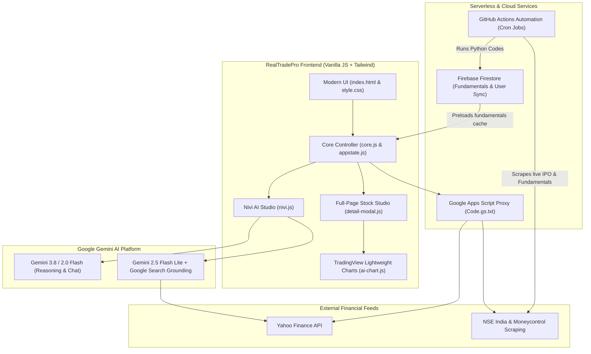

# 🚀 RealTradePro (RTP) — Next-Gen Indian Stock Market & AI Trading Platform

<p align="center">
  
  
  
  
  
  
</p>

---

## 📖 Overview

**RealTradePro (RTP)** is a high-performance, real-time Indian stock market analytics suite, virtual paper-trading terminal, and AI financial copilot. Built with modern glassmorphism aesthetics, zero-build-step client architecture, and enterprise-grade financial intelligence, RTP brings together live NSE/BSE market tracking, technical screening, institutional fund flows, and advanced Gemini-driven intelligence into a single unified experience.

Whether you are tracking intraday price action, screening swing setups, reviewing quarterly balance sheets, or asking **Nivi AI** for deep technical targets and risk-reward setups, RealTradePro provides real-time, low-latency, and actionable market intelligence.

---

## ✨ Key Features & Capabilities

### 1. 📈 Live Market Terminal & Dynamic Watchlists
- **Real-Time NSE / BSE Tracking:** Live quotes, day change, % momentum, Day High/Low, and 52-Week High/Low.
- **Multiple Watchlists:** Toggle between default watchlists (*Watchlist 1, 2, 3*) or create, rename, and manage custom watchlists on the fly.
- **Top Indices Ticker:** Real-time ticker strip featuring **NIFTY 50, GIFT NIFTY, SENSEX, and BANK NIFTY**, with single-click modal to track any custom sectoral or global index.
- **Smart Symbol Search:** Instant live auto-suggest for Indian equities with quick addition to the active watchlist.
- **Multi-Factor Sorting:** Instant 1-click sorting by **A-Z (Alphabetical)**, **Price (LTP)**, or **Percentage Gain/Loss (%)**.

### 2. 🔍 Full-Page Stock Detail Studio (`detail-modal.js`)
Instead of cramped popups, clicking any stock launches an immersive full-screen analysis page:
- **Interactive Candlestick Chart:** Embedded TradingView Lightweight Candlestick chart with timeframes and volume bars.
- **Live Price Statistics:** Open, Previous Close, Intraday High/Low, 52W High/Low with visual range indicator.
- **Deep Fundamental Metrics:** Auto-cached P/E Ratio, EPS, Market Capitalization, Book Value, and Price-to-Book.
- **Technical Analysis Dashboard:** Real-time calculation of **RSI (14)**, Moving Averages (SMA/EMA 20, 50, 200), MACD, Supertrend, and Pivot Levels (Support/Resistance).
- **Bollinger Bands & Volatility:** Dedicated Bollinger Bands (BB) indicator tab with upper, middle, and lower bands.
- **External Research Launchpad:** Direct 1-click shortcuts to **Screener.in, Google Finance, Moneycontrol, Trendlyne, and NSE India**.

### 3. 🧠 Nivi AI Studio (`nivi.js` & `gemini.js`)
RTP features **Nivi AI**, a dedicated financial analyst copilot:
- **Dual Gemini Intelligence Engine:**
  - **Gemini 3.8 & 2.0 Flash:** Primary high-reasoning conversational brain for technical and strategic financial advice.
  - **Gemini 2.5 Flash Lite with Google Search Grounding:** Real-time web retrieval for live prices, quarterly earnings reports, and breaking corporate actions.
  - Automatic fallback cascade across `gemini-3.8` ➔ `gemini-2.5-flash-lite` ➔ `gemini-2.0-flash` ➔ `gemini-1.5-flash`.
- **📈 AI Candle Chart:** Interactive chart with AI-driven automated trendline detection, pattern recognition, and structured technical commentary.
- **💬 Nivi Copilot Chat:**
  - **⛶ Expand (Fullscreen Focus Mode):** Seamless 100vh reading mode designed to view lengthy, multi-page stock analyses without scroll fatigue.
  - **Trading KPI Badges:** Automatic syntax highlighter turning AI output into trading stat pills:
    - 🎯 **Target:** Emerald Green badge (`🎯 Target: ₹...`)
    - 🛑 **Stoploss:** Coral Red badge (`🛑 Stoploss: ₹...`)
    - 📊 **RSI:** Cyan Blue badge (`📊 RSI: ...`)
    - ▲ **Bullish** / ▼ **Bearish:** High-visibility trend badges.
  - **Multimodal Chart & Document Vision:** Attach chart screenshots, balance sheets, or PDF reports; Nivi inspects patterns, support levels, and financial tables directly.
  - **1-Click Copy:** Instant clipboard copy on every AI response card with visual toast confirmation.
  - **Collapsible Quick Prompts:** Space-saving prompt suggestions (*Market Mood, Target & Stoploss, Sector Outlook*) that collapse during active conversations.
  - **Financial Guardrails:** Strict anti-hallucination protocols, SEBI advisory disclaimers, and native Gujarati / Hindi / English language understanding.
- **📰 AI Market Intelligence (Insights):** Automated algorithm compiling daily movers, sector rotation, and market sentiment updates.

### 4. 🏛️ Markets Hub: Institutional Flows & IPO Tracker
- **🏛️ FII / DII Flow Tracker:** Daily institutional cash flow updates showing Foreign Institutional Investors (FII) vs. Domestic Institutional Investors (DII) net buying and selling figures.
- **⚡ IPO Central:** Real-time tracking of ongoing, upcoming, and recently listed IPOs, subscription rates, Grey Market Premium (GMP), and listing gains.
- **📊 Indices & Sector Breadth:** Performance tracking across NIFTY Bank, NIFTY IT, Auto, Pharma, Metal, FMCG, and Realty with Advance/Decline ratios.
- **📋 Financials Dashboard:** Live company quarterly financials, revenue trajectories, and operating profit trends.

### 5. 💼 Paper Trading Terminal & Portfolio Tracker
- **Virtual Paper Trading:** Simulate real-world trades without risking capital.
- **Live P&L Tracking:** Real-time position evaluation based on live market ticks.
- **Holdings & Positions:** Average purchase price, current value, invested amount, and percentage return breakdown.
- **Order Management:** Place simulated Market / Limit orders with Target and Stop-Loss configurations.

### 6. 🔔 Real-Time Price Alerts & Technical Scanners
- **Custom Price Threshold Alerts:** Sound & browser push alerts triggered when a stock breaches user-defined support or resistance price points.
- **Automated Technical Scanners:**
  - RSI Overbought (>70) and Oversold (<30) screening.
  - Moving average crossovers (Golden Cross / Death Cross).

### 7. 👤 Multi-Profile PIN Security & Cloud Sync
- **Multi-User Profiles:** Switch seamlessly between accounts (e.g. *Sahaj, Dad, Mom*).
- **Security:** 4-digit PIN authentication with security question recovery mechanism.
- **Dual Storage Engine:** Instant offline storage via `localStorage` paired with cloud backup and cross-device sync via **Firebase Firestore**.
- **Modern Themes:** Fluid switching between Dark Glassmorphic Theme and Light Mode.

---

## 🏗️ System Architecture & Data Flow



---

## 📁 Repository Directory Structure

```plaintext
realtradepro/
├── 📄 index.html              # Main application single-page structure & subtabs layout
├── 🎨 style.css                # Custom glassmorphic CSS, animations, responsive design & themes
├── ⚙️ core.js                  # App lifecycle, routing, tab management, search & indices strip
├── 🧠 nivi.js                  # Nivi AI Copilot, streaming chat, fullscreen mode & KPI badges
├── 🤖 gemini.js                # Gemini API integration, search grounding & multi-model fallback
├── 📊 ai-chart.js              # Lightweight Charts integration, automated AI technical drawings
├── 🔍 detail-modal.js          # Full-page stock details (chart, metrics, technicals, external links)
├── ⚡ indices.js               # Top indices row calculation, sectoral tracking & indices modal
├── 📈 price.js                 # Real-time quote polling, price formatting & change calculations
├── 📐 technical.js             # Technical indicator algorithms (RSI, SMA, EMA, MACD, Bollinger)
├── 💼 holdings.js              # Portfolio management, holdings calculation & asset allocation
├── 📝 trades.js                # Paper trading execution engine, buy/sell logic & trade log
├── 🔔 alerts.js                # Price alerts, threshold monitoring & sound notifications
├── 📚 learn.js                 # Trading academy, candlestick patterns & market handbook
├── 🌐 api.js                   # Network abstraction, GAS endpoints & rate-limit handling
├── 💾 appstate.js              # Global centralized reactive state container
├── 🔥 firebase-sync.js         # Firebase Firestore synchronization & multi-device sync
├── 🔐 auth.js                  # User profile switcher, 4-digit PIN hash & security reset
├── 📡 marketdata.js            # Market breadth, advance-decline & volume momentum calculations
├── ⏱️ live-price.js             # Intraday quote stream parser & ticker updates
├── 🛠️ settings.js              # API keys manager, theme selector, cache clearing & preferences
├── 🌓 theme.js                 # Dark & light theme engine with CSS variable switching
├── 🧰 utils.js                 # Math formatters, currency symbols, date utilities & sanitizers
├── 📋 Code.gs.txt              # Google Apps Script serverless proxy & backend sync code
├── 🐍 Python Codes/            # Background automation & scraping scripts
│   ├── fundlearn.py            # Fundamentals scraper (P/E, EPS, Market Cap) -> Firestore
│   ├── livemarket.py           # Real-time market breadth, gainers & losers sync
│   ├── ipoji_sync.py           # IPO GMP, status & subscription rate tracker
│   └── olhcv.py                # Historical OHLCV candlestick data extractor
└── ⚙️ .github/workflows/       # GitHub Actions automated scheduled cron jobs
    ├── livemarket.yml          # Executes livemarket.py on market hours
    ├── fundlearn.yml           # Executes fundlearn.py to update fundamentals
    └── olhcv.yml               # Scheduled historical price update workflow
```

---

## 🚀 Getting Started & Local Setup

### Prerequisites
- Any modern web browser (Google Chrome, Microsoft Edge, Brave, Safari, Firefox).
- Python 3.8+ (for local HTTP server, or simply use VS Code Live Server).

### 1. Clone the Repository
```bash
git clone https://github.com/sahaj-droid/realtradepro.git
cd realtradepro
```

### 2. Launch Local Development Server
Because RealTradePro is a client-side web application without node build steps, you can serve it with any lightweight HTTP server:

**Using Python:**
```bash
python -m http.server 5500
```
**Using Node.js (npx):**
```bash
npx serve -l 5500
```

Now open your browser and navigate to:  
👉 **`http://localhost:5500`**

---

## 🔑 Configuration & API Keys

### 1. Google Gemini AI Setup (For Nivi AI)
1. Get a free Gemini API key from [Google AI Studio](https://aistudio.google.com/).
2. In RealTradePro, click on the **Profile / Settings** icon (top right).
3. Under **Gemini API Key**, enter your API key and click **Save**.
4. Nivi AI Copilot will automatically activate with live streaming responses!

### 2. Firebase Firestore Setup (For Cloud Sync & Fundamentals)
The app is pre-configured with Firebase Firestore for fundamental data caching. If using your own Firebase project:
1. Open [`index.html`](index.html) and locate `firebaseConfig`.
2. Replace with your Firebase project credentials:
```javascript
const firebaseConfig = {
  apiKey: "YOUR_API_KEY",
  authDomain: "your-app.firebaseapp.com",
  projectId: "your-app",
  storageBucket: "your-app.firebasestorage.app",
  messagingSenderId: "...",
  appId: "..."
};
```

### 3. Google Apps Script Proxy (`Code.gs.txt`)
To bypass browser CORS restrictions when fetching live Indian stock quotes:
1. Create a new project on [script.google.com](https://script.google.com/).
2. Copy the contents of [`Code.gs.txt`](Code.gs.txt) into `Code.gs`.
3. Click **Deploy ➔ New Deployment ➔ Web App** (Access: *Anyone*).
4. Paste the generated deployment URL into `api.js` or **Settings ➔ GAS URL**.

---

## 🤖 Supported Gemini AI Models

| Model | Purpose | Grounding Tool |
|---|---|:---:|
| `gemini-3.8` | Primary Conversational Brain, In-Depth Strategic Reasoning | Technical Insights |
| `gemini-2.5-flash-lite` | Real-Time News, Live Stock Prices, Quarterly Results | Google Search Grounding |
| `gemini-2.0-flash` | High-Speed Fallback Chat & Multi-turn Dialogue | Conversational Analysis |
| `gemini-1.5-flash` | High-Quota Reliable Backup Engine | Safe Fallback |

---

## 🛡️ Disclaimers & Regulatory Notice

> [!IMPORTANT]
> **Educational & Analytical Purpose Only:**  
> RealTradePro (RTP) and Nivi AI are built purely for research, paper trading, and educational purposes. Neither the application nor Nivi AI is a SEBI-registered investment advisor or research analyst. Stock market investments are subject to market risks. Always conduct your own independent technical and fundamental research or consult a certified financial advisor before executing real trades.

---

## 👨‍💻 Author & Acknowledgements

- **Developer:** Sahaj ([@sahaj-droid](https://github.com/sahaj-droid))
- **Co-Developed With:** [Google Antigravity](https://antigravity.google/) (Advanced Agentic Pair Programming)
- **Libraries & Tools:** TradingView Lightweight Charts, Tailwind CSS, Google Gemini API, Firebase Firestore.

---

<p align="center">
  <b>⭐ If you find RealTradePro useful, please consider starring this repository! ⭐</b>
</p>
